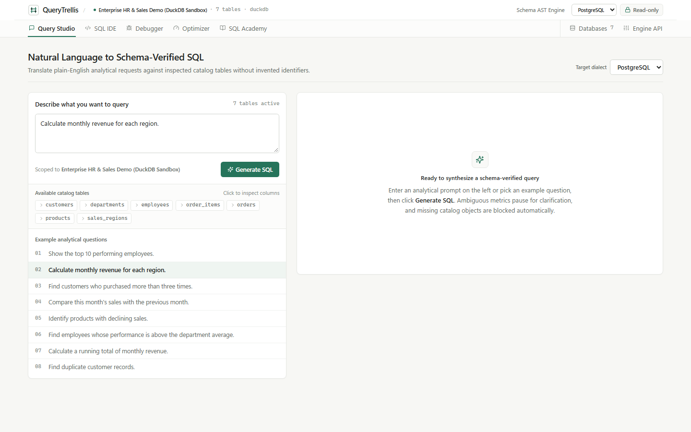

# QueryTrellis Studio — Natural Language SQL Development, Optimization & Visual Learning Platform

**Day 17 of the 90 Days – 90 Projects Challenge**

QueryTrellis Studio is a full-stack, schema-grounded **Natural Language SQL Development, Multi-Dialect SQL Editor, Debugging, Query Optimization, and Visual SQL Learning Platform**, seamlessly extending the preserved **QueryTrellis PostgreSQL Performance Workbench**.

Built with **Python + FastAPI + SQLGlot + DuckDB + Next.js 15 + React 19 + Tailwind CSS v4 + Local Monaco Editor**, QueryTrellis Studio runs **100% locally offline by default** with zero paid APIs, zero external telemetry, and strict database safety guardrails.



*More workspace views in [`screenshots/README.md`](screenshots/README.md).*

---

## Table of Contents

1. [Platform Capabilities & 7 Workspaces](#platform-capabilities--7-workspaces)
2. [Multi-Dialect SQL Engine (PostgreSQL, MySQL, SQLite, SQL Server)](#multi-dialect-sql-engine)
3. [Schema-Grounded NL-to-SQL & Ambiguity Resolution](#schema-grounded-nl-to-sql--ambiguity-resolution)
4. [Zero-Daemon AST Engine & Opt-In Cloud API Gateway](#zero-daemon-ast-engine--opt-in-cloud-api-gateway)
5. [Three-Tier Query Optimization & Preserved PostgreSQL Benchmarks](#three-tier-query-optimization--preserved-postgresql-benchmarks)
6. [Visual SQL Academy (21 Interactive Lessons + Custom Query Tracer)](#visual-sql-academy)
7. [Safe Execution, Write Guardrails & Credential Hygiene](#safe-execution-write-guardrails--credential-hygiene)
8. [Windows Quickstart (`setup.bat`, `run.bat`, `test.bat`)](#windows-quickstart)
9. [Datasets & Sample Files](#datasets--sample-files)
10. [Project Structure & Documentation Index](#project-structure--documentation-index)
11. [Automated Test Suite](#automated-test-suite)
12. [License](#license)

---

## Platform Capabilities & 7 Workspaces

QueryTrellis Studio pairs a FastAPI backend (`src/api/`) with a precision Next.js 15 workbench (`frontend/`) hosted locally at `http://127.0.0.1:3000`:

| Workspace | Route | Key Capabilities |
|---|---|---|
| **Query Studio** | `/` · `/query-studio` | Translates natural language requests against the active database schema (with expandable inline catalog column inspection), asks structured clarification questions when requests are ambiguous, refuses nonexistent entities without fabricating identifiers, displays AST-accurate clause explanations and illustrative projection structure, and runs **Show Sample Output** against live data. |
| **SQL IDE** | `/sql-editor` | Split-pane Schema Explorer + offline-bundled Monaco SQL editor (`monaco-editor` with zero CDN calls), AST validation markers, SQL formatting, sortable/filterable/paginated Results Explorer with column stats and CSV/TSV/JSON export, Clause-by-Clause Explanation, Dialect Converter, and Read-Only / HMAC-confirmed Opt-In Write Mode. |
| **Debugger** | `/debugging` | Diagnoses syntax errors, missing tables/columns, ambiguous unqualified identifiers, missing `JOIN ON` predicates, `= NULL` three-valued logic bugs, missing `GROUP BY` columns, and datatype mismatches. Automatically builds and safe-tests candidate fixes and displays an interactive Monaco Diff (`Apply Correction` / `Test Correction` / `Reject`). |
| **Optimizer** | `/optimizer` | Strictly enforces three non-overlapping tiers: **(1) Static AST Suggestions & Index DDL** (zero execution), **(2) Non-Executing Estimated Execution Plan (`EXPLAIN`)**, and **(3) Opt-In Measured Performance (`EXPLAIN ANALYZE`)** with side-by-side original vs. rewrite A/B timing and row-count equivalence verification. |
| **SQL Academy** | `/academy` | Interactive **21-lesson curriculum** across Beginner, Intermediate, Advanced, and Storage & DML tiers with DuckDB stage-by-stage execution traces (`Play/Pause`, `Step`, speed control, row kept/excluded/NULL-padded/modified highlights), progressive hints, step-by-step solutions, live exercise evaluator, and a **Custom Query Tracer**. |
| **Databases** | `/database-manager` | Upload `.sql`, `.dump`, `.csv`, `.xlsx`, and `.json` files with inspect-before-accept schema previews into isolated DuckDB sandboxes, switch between bundled sample datasets or **Enterprise HR & Sales Demo**, connect live external **PostgreSQL, MySQL, SQLite, or SQL Server** databases, inspect tables/PKs/FKs, or reset cleanly with **Reset Demo**. |
| **Engine API** | `/ai-settings` | Switch between the default **Deterministic Schema AST Engine** (zero local agents, zero background daemons) and optional consent-gated **External Cloud API Gateway** (OpenAI, OpenAI-compatible, Anthropic, Gemini) with session-only API key memory. |

> **Legacy Streamlit PostgreSQL Workbench Preserved:** All original PostgreSQL monitoring, `EXPLAIN (ANALYZE, BUFFERS)` inspection, benchmark runs, SQLite metadata history, and sanitized reporting pages remain intact in `app/main.py` (`http://127.0.0.1:8501`).

---

## Multi-Dialect SQL Engine

Every parse, validation, format, and conversion operation is backed by **SQLGlot AST transformations** (`src/dialects/sqlglot_engine.py`) across:

- **PostgreSQL** (`postgres` — double-quote identifiers, `DATE_TRUNC`, `ILIKE`, `LIMIT ... OFFSET ...`, `STRING_AGG`)
- **MySQL** (`mysql` — backtick identifiers, `DATE_FORMAT`, `GROUP_CONCAT`, `AUTO_INCREMENT`)
- **SQLite** (`sqlite` — double-quote identifiers, `strftime`, `GROUP_CONCAT`, `AUTOINCREMENT`)
- **Microsoft SQL Server / T-SQL** (`tsql` — bracket identifiers, `TOP n` / `OFFSET ... FETCH NEXT`, `DATETRUNC`, `+` string concat transpilation to DuckDB)

Non-equivalent constructs (e.g., `DISTINCT ON`, `GENERATE_SERIES()`, `RETURNING`, `FULL OUTER JOIN` in MySQL, `OFFSET` without `ORDER BY` in T-SQL) surface explicit warnings and limitations instead of silent keyword replacement.

---

## Schema-Grounded NL-to-SQL & Ambiguity Resolution

`src/nl2sql/ambiguity.py`, `src/nl2sql/generator.py`, and `src/nl2sql/explainer.py` enforce strict schema grounding against the active `DatabaseContextSnapshot`:

1. **Missing-Schema Guard:** Requests targeting entities absent from the active database (e.g., airline flights, hospital patients) are refused cleanly with an inventory of actual tables rather than fabricating identifiers.
2. **Structured Ambiguity Clarification:** Underspecified requests trigger interactive interpretation selection before generating SQL:
   - *"Show the top 10 performing employees"* -> Total revenue generated / Number of sales / Profit generated / Target achievement %
   - *"Compare this month's sales with the previous month"* -> Latest dataset month vs. calendar `CURRENT_DATE`
   - *"Identify products with declining sales"* -> Latest month MoM drop / 2 consecutive declines / First half vs. second half
   - *"Find duplicate customer records"* -> Normalized email vs. customer name + country
3. **Zero Fabricated Sample Output:** Clause breakdowns include illustrative column projections only; clicking **Show Sample Output** queries real rows from the active database under safe read-only limits.

---

## Zero-Daemon AST Engine & Opt-In Cloud API Gateway

1. **Deterministic Schema AST Engine (Default):** Runs completely offline in-process with zero local agents, zero background model daemons, and zero network latency—assembling schema-verified SQL CTEs/windows/joins via SQLGlot (`verify_sql_against_schema`) across all four supported engines.
2. **External Cloud API Gateway (Opt-In & Consent-Gated):** Disabled by default (`external_data_consent=False`). Requires explicit checkbox authorization in **Engine API** (`/ai-settings`) and holds optional OpenAI/Anthropic/Gemini keys purely in server memory—never written to disk, logs, SQLite, or API JSON responses. Automatically falls back to the Deterministic Schema AST Engine whenever external APIs are unreachable or emit unverified identifiers.

---

## Three-Tier Query Optimization & Preserved PostgreSQL Benchmarks

QueryTrellis strictly distinguishes static analysis from estimated plans and live timed runs (`src/optimizer/engine.py`):

- **Tier 1 (Static Analysis Only):** Runs 15 PostgreSQL/ANSI SQL anti-pattern rules (`AP001`–`AP015`), non-redundant advisory index DDL generation, and AST rewrite alternatives without opening a DB execution transaction.
- **Tier 2 (Estimated Plan Only):** Executes `EXPLAIN` (without `ANALYZE`) to inspect planner scan/join operators without running the query.
- **Tier 3 (Opt-In Measured Performance):** Executes timed runs / `EXPLAIN ANALYZE` **only when explicitly enabled by the user**, returning real execution duration and verifying row-count equivalence between baseline and candidate rewrites.

Preserved PostgreSQL 18.6 verified benchmark runs on the 281,525-row `querytrellis_sample` database remain reproducible via [`scripts/run_benchmarks.py`](scripts/run_benchmarks.py) and [`reports_examples/benchmark_comparisons.json`](reports_examples/benchmark_comparisons.json).

---

## Visual SQL Academy

The interactive learning workspace (`src/academy/curriculum.py`, `src/academy/stage_tracer.py`, `src/academy/exercise_evaluator.py`) runs in an isolated DuckDB sandbox (`staff`, `teams`, `deals`, `leads_archive`) with:

- **21 Progressive Lessons:**
  - *Beginner (1–7):* `SELECT`, `FROM`, `WHERE`, `ORDER BY`, `LIMIT`, `DISTINCT`, `Aggregate Functions`
  - *Intermediate (8–15, 17):* `GROUP BY`, `HAVING`, `INNER JOIN`, `LEFT JOIN`, `RIGHT JOIN`, `Subqueries`, `CTEs (WITH)`, `CASE`, `UNION vs UNION ALL`
  - *Advanced (16):* `Window Functions (RANK / SUM OVER)`
  - *Storage & DML (18–21):* `INSERT`, `UPDATE`, `DELETE`, `Index Fundamentals (Seq Scan vs B-Tree)`
- **Step-by-Step Stage Tracer & Custom SELECT Visualizer:** Traces `FROM/JOIN` -> `WHERE` -> `GROUP BY` -> `HAVING` -> `WINDOW` -> `SELECT` -> `DISTINCT` -> `ORDER BY` -> `LIMIT/FINAL` with per-row badges (`kept`, `excluded`, `padded_null`, `added`, `modified`).

---

## Safe Execution, Write Guardrails & Credential Hygiene

- **Read-Only by Default (`src/security/guardrails.py`):** AST inspection rejects `INSERT`, `UPDATE`, `DELETE`, `DROP`, `ALTER`, `TRUNCATE`, write CTEs, multi-statement batches, `SELECT ... INTO`, `FOR UPDATE/SHARE`, filesystem table functions (`read_csv`, `read_parquet`), `COPY`, `ATTACH`, and admin functions (`pg_sleep`, `pg_terminate_backend`).
- **HMAC-Verified Opt-In Write Mode:** Even when a user unlocks write mode in **Database Manager**, any write/DDL statement requires an interactive **HMAC-SHA256 confirmation challenge** bound strictly to `(target_database, dialect, SQL)`.
- **Tabulated Importer Honesty (`src/importers/tabular_importer.py`):** CSV, Excel (`.xlsx`), and JSON imports preview inferred types first and **never fabricate synthetic foreign keys**. SQL/dump imports strip procedural metacommands (`\connect`, `SET`, `LOCK TABLES`, `COPY ... FROM stdin`) safely before building isolated DuckDB sandboxes.
- **Zero Persisted Secrets:** Database passwords and external AI API keys live exclusively in process memory and are scrubbed from diagnostic messages (`sanitize_error_message`).

---

## Windows Quickstart

### Prerequisites
- **Windows 10 / 11**
- **Python 3.11+** on `PATH` (tested on Python 3.14.7)
- **Node.js 20+** and `npm` on `PATH`
- *(Optional)* Live **PostgreSQL / MySQL / SQL Server** databases or an explicit opt-in cloud API key (runs 100% offline out-of-the-box without external credentials)

### 1. Automated Setup, Build & Sample Data

```powershell
git clone <your-repo-url>
cd 90-days-90-projects-day-17-querytrellis
.\setup.bat
```

`setup.bat` creates `.venv`, installs Python requirements, runs `npm --prefix frontend install` and `npm --prefix frontend run build`, preserves any existing `.env` (or copies `.env.example`), and seeds the **Enterprise HR & Sales Demo (`demo_enterprise.duckdb`)** plus `sample_data/`.

### 2. Launch Full-Stack QueryTrellis Studio

```powershell
.\run.bat
```

- **Next.js Workbench UI (Light-First Editorial SQL Workstation):** `http://127.0.0.1:3000`
- **FastAPI Backend Docs:** `http://127.0.0.1:8000/docs`
- **Legacy Streamlit Performance Workbench (optional):**
  `.\.venv\Scripts\python.exe -m streamlit run app/main.py` (`http://127.0.0.1:8501`)

---

## Datasets & Sample Files

1. **Active Enterprise HR & Sales Demo (`data/sandboxes/demo_enterprise.duckdb`):** Created deterministically with **7 related tables** (`sales_regions`, `departments`, `employees` [16 rows], `customers`, `products`, `orders`, `order_items`) and declared FK constraints, supporting realistic cross-month, declining-sales, duplicate customer, and quota/profit queries immediately on first launch.
2. **Bundled Sample Uploads (`sample_data/`):**
   - `hr_sales_schema.sql` (DDL + seed SQL)
   - `monthly_revenue.csv` (tabular CSV import sample)
   - `product_catalog.json` (JSON import sample)
   - `regional_targets.xlsx` (Excel workbook import sample)
3. **Preserved PostgreSQL 281,525-Row Benchmark DB (`querytrellis_sample`):** Setup documented in [`QUICKSTART.md`](QUICKSTART.md) and [`sql/schema.sql`](sql/schema.sql).

---

## Project Structure & Documentation Index

```text
90-days-90-projects-day-17-querytrellis/
├── frontend/                  # Next.js 15 + React 19 + Tailwind v4 + Local Monaco UI
│   ├── next.config.ts
│   └── src/
│       ├── app/               # query-studio, sql-editor, debugging, optimizer, academy, database-manager, ai-settings
│       ├── components/        # AppShell, MonacoSqlEditor, MonacoDiffPanel, ResultsExplorer, StageTraceViewer, SchemaExplorerTree
│       └── lib/               # Typed API client, workspace React context, shared TypeScript contracts
├── src/
│   ├── api/                   # FastAPI entrypoint (main.py), state container, & 7 REST routers
│   ├── ai/                    # Deterministic fallback config & opt-in External Cloud API adapter, prompt builder
│   ├── dialects/              # SQLGlot AST parser, formatter, multi-dialect converter, DuckDB transpiler
│   ├── nl2sql/                # Ambiguity detector, deterministic planner, AST explainer & schema verifier
│   ├── connectors/            # MultiDBConnector (DuckDB sandboxes, PostgreSQL, MySQL, SQLite, SQL Server) & demo_enterprise seed
│   ├── importers/             # Preview-before-accept SQL/dump AST importer & CSV/XLSX/JSON tabular importers
│   ├── debugger/              # Schema/logic/syntax diagnostic assistant & verified candidate fix builder
│   ├── optimizer/             # 3-tier engine (Tier 1 Static + Index DDL, Tier 2 EXPLAIN, Tier 3 Opt-In Timed A/B)
│   ├── academy/               # 21-lesson SQL curriculum, step-by-step DuckDB stage tracer, exercise evaluator
│   ├── security/              # AST read-only guardrails, HMAC write challenge, credential redaction
│   └── ...                    # Preserved PostgreSQL workbench modules (db, sql_analysis, explain, advisor, benchmark, reporting, services)
├── app/                       # Preserved Streamlit PostgreSQL Performance Workbench UI
├── sample_data/               # Ready-to-upload .sql, .csv, .json, and .xlsx sample datasets
├── tests/                     # Pytest backend suites covering dialects, security, importers, NL2SQL, debugger, optimizer, academy & API
├── setup.bat / run.bat / test.bat
└── docs/                      # Architecture, User Guide, Development Notes, Testing & Troubleshooting guides
```

Additional documentation:
- [`QUICKSTART.md`](QUICKSTART.md) · [`DEMO_SCRIPT.md`](DEMO_SCRIPT.md) · [`docs/ARCHITECTURE.md`](docs/ARCHITECTURE.md) · [`docs/USER_GUIDE.md`](docs/USER_GUIDE.md) · [`docs/TESTING.md`](docs/TESTING.md)

---

## Automated Test Suite

Run both the full Python backend test suite (`pytest` + coverage) and Next.js TypeScript typecheck:

```powershell
.\test.bat
```

Or run individual checks directly:

```powershell
.\.venv\Scripts\python.exe -m pytest -v tests/ --cov=src --cov-report=term-missing
npm --prefix frontend run typecheck
npm --prefix frontend run build
```

*(Verified offline suite result: `97 passed, 1 skipped` with `74%` statement coverage across `src/`, plus `tsc --noEmit` and `next build` static/runtime build across all 12 routes and live full-stack E2E verification. `tests/test_postgres_integration.py` skips cleanly when no live PostgreSQL test instance is configured via `QT_TEST_PG_*`.)*

---

## License

Released under the [MIT License](LICENSE) — Copyright (c) 2026 Ragu Ram.
