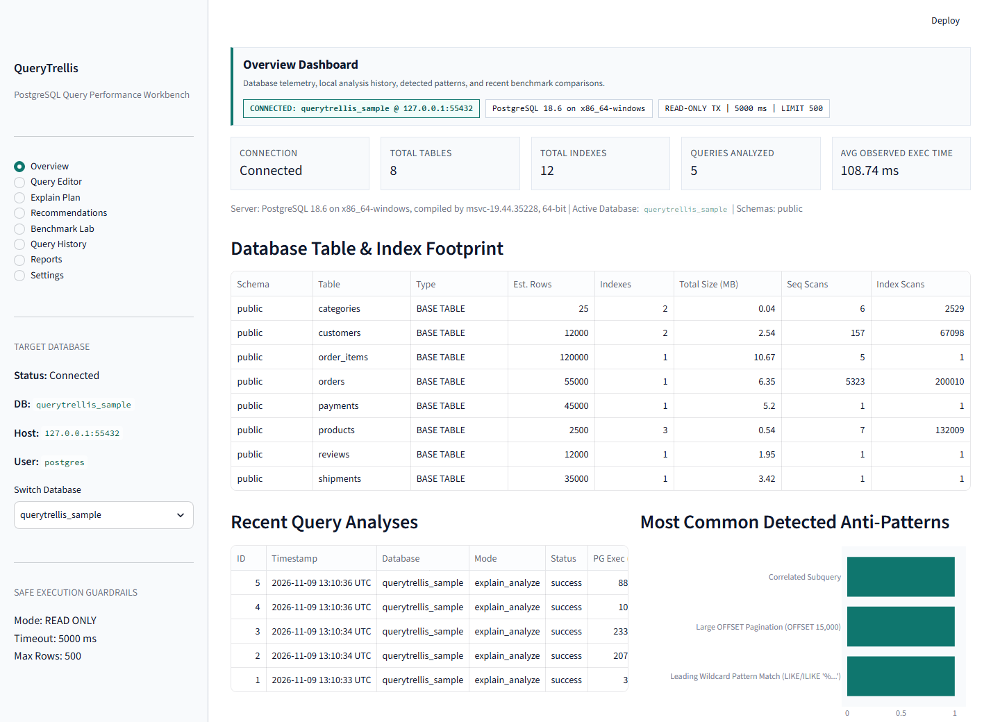
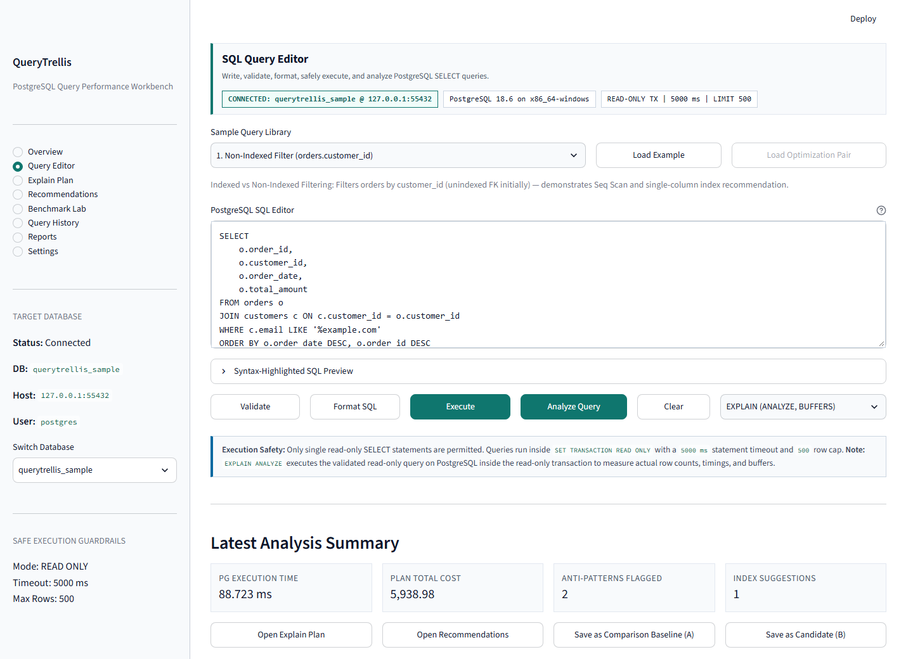
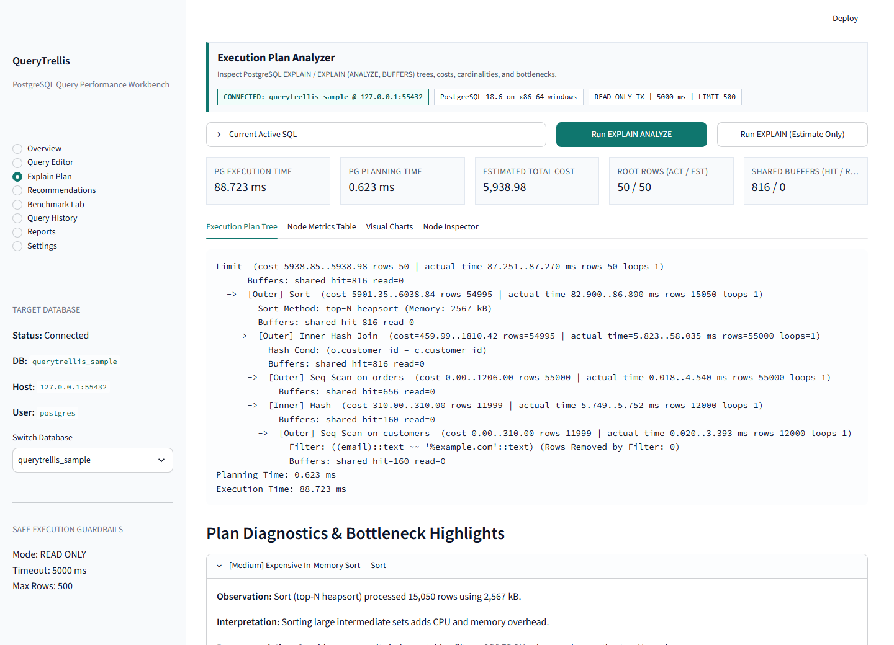
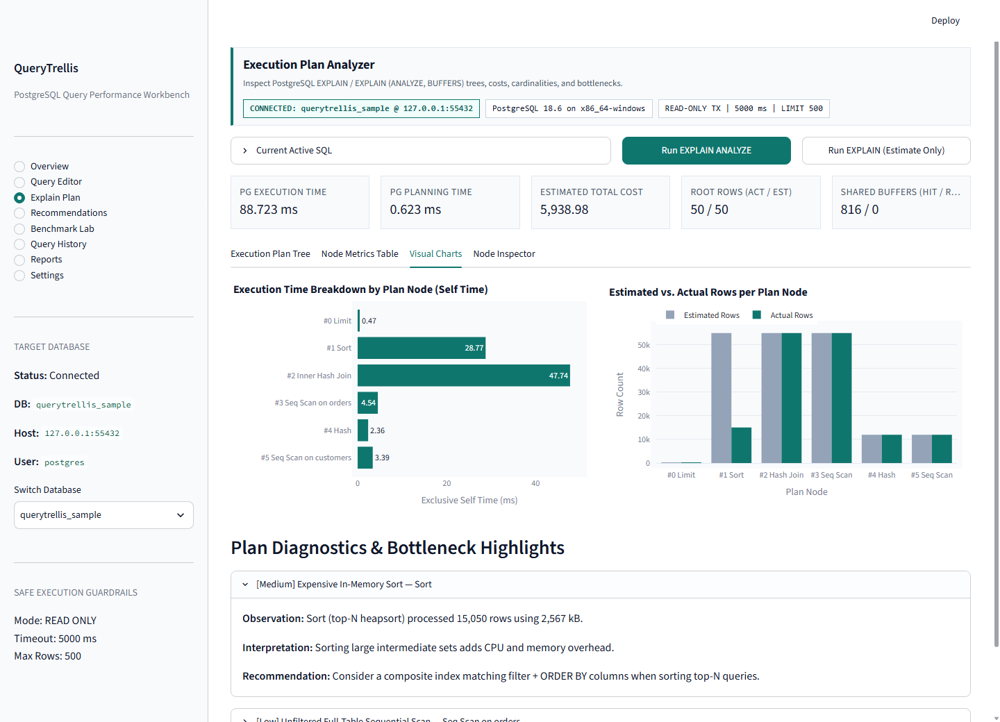
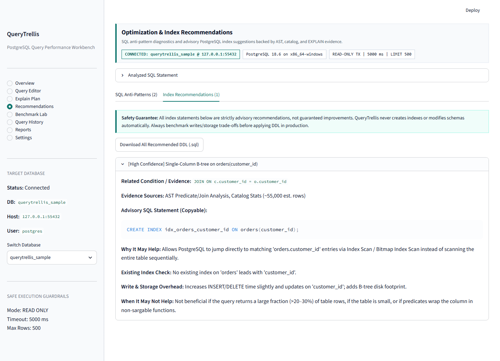
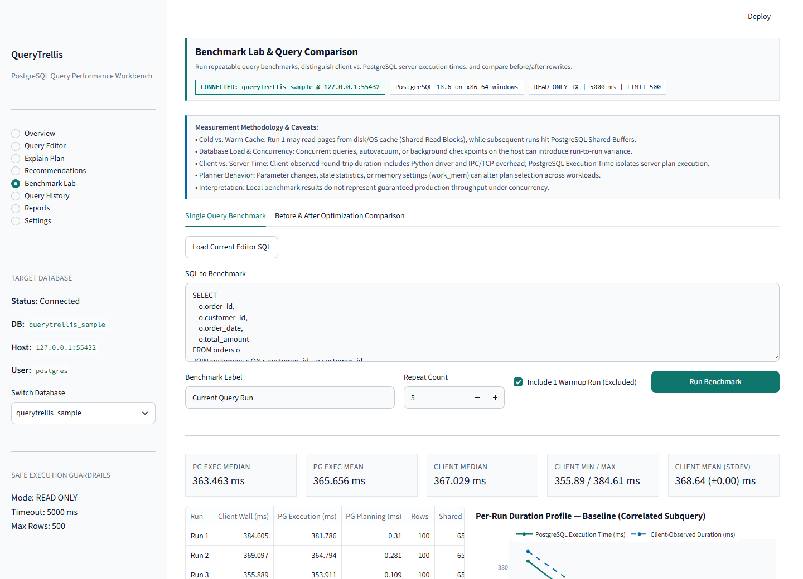
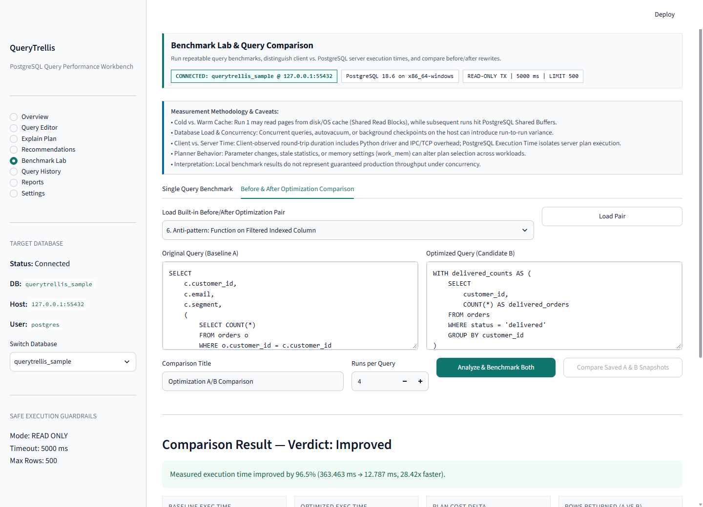
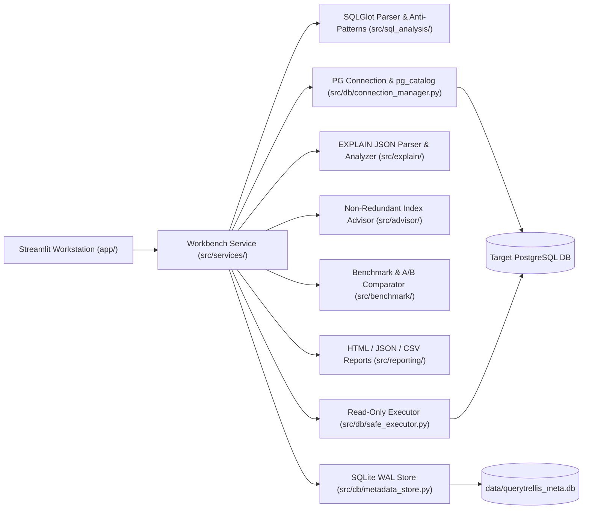

# QueryTrellis — PostgreSQL Query Performance & Optimization Workbench

**Day 17 of the 90 Days – 90 Projects Challenge**

QueryTrellis is a local, safety-first **PostgreSQL SQL inspection, execution plan analysis, benchmarking, and optimization workbench** built with Python, Streamlit, `psycopg` v3, SQLGlot, Pandas, and Plotly. It operates 100% locally with **zero external LLM calls, zero paid APIs, and zero cloud dependencies**.



---

## Table of Contents

1. [Why QueryTrellis?](#why-querytrellis)
2. [Core Capabilities](#core-capabilities)
3. [Before & After Benchmark Results (Verified on PostgreSQL 18.6)](#before--after-benchmark-results-verified-on-postgresql-186)
4. [UI Walkthrough & Screenshots](#ui-walkthrough--screenshots)
5. [Architecture & Module Design](#architecture--module-design)
6. [Safe Execution & Security Model](#safe-execution--security-model)
7. [Quickstart & Windows Setup](#quickstart--windows-setup)
8. [Sample E-Commerce Database (`querytrellis_sample`)](#sample-e-commerce-database-querytrellis_sample)
9. [Automated Test Suite](#automated-test-suite)
10. [Project Structure](#project-structure)
11. [Documentation Index](#documentation-index)
12. [Known Limitations](#known-limitations)
13. [License](#license)

---

## Why QueryTrellis?

Queries that look clean and instantaneous on tiny seed tables frequently degrade in production because of:

- **Non-sargable predicates** (`WHERE LOWER(email) = ...` or `EXTRACT(YEAR FROM order_date) = 2025`) bypassing B-tree indexes
- **Missing indexes on PostgreSQL foreign keys** (PostgreSQL indexes primary/unique keys automatically, **not** referencing FK columns)
- **Correlated scalar subqueries** executed repeatedly across outer rows (`SubPlan`)
- **Leading-wildcard filters** (`LIKE '%example.com'`) paired with deep `OFFSET` pagination (`O(OFFSET + LIMIT)`)
- **Cardinality misestimates & disk-spilling sorts** hidden inside multi-level raw `EXPLAIN (ANALYZE, BUFFERS)` text output

QueryTrellis turns raw PostgreSQL planner output and AST inspection into an interactive workbench that shows *why* a query is slow, verifies *when* a pattern is acceptable vs. harmful (e.g., Sequential Scans on tiny 25-row lookup tables), suggests non-redundant advisory indexes backed by `pg_catalog` evidence, and proves speedup with repeatable side-by-side benchmarks.

---

## Core Capabilities

| Module | What It Does |
|---|---|
| **PostgreSQL Connection Manager** | Supports local/custom host, port, DB switching, server version check, live table/column/index/FK metadata introspection via `pg_catalog`, friendly error translation, and memory-only password handling |
| **SQL Query Editor** | Monospace editor, SQLGlot syntax formatting, offline AST validation, syntax-highlighted preview, 9 categorized sample queries (with paired optimization rewrites), history, and CSV result export |
| **Safe Read-Only Executor** | Rejects DML/DDL/DCL, write CTEs, multi-statement batches, `SELECT ... INTO`, and row locks via SQLGlot AST inspection before opening `SET TRANSACTION READ ONLY` with configurable `statement_timeout` and capped server-cursor fetches |
| **SQL Anti-Pattern Detector** | Evaluates 15 AST + catalog-aware rules (`AP001`–`AP015`): `SELECT *`, missing `WHERE` on large tables, functions on filtered columns, leading wildcards, unnecessary `DISTINCT`, correlated/repeated subqueries, large `OFFSET`, `OR` across columns, inner `ORDER BY`, implicit type coercion, nested wrappers, suspicious/non-equi joins, with nuance explaining when each pattern is acceptable |
| **EXPLAIN Plan Analyzer** | Parses `EXPLAIN (FORMAT JSON)` and `EXPLAIN (ANALYZE, BUFFERS, FORMAT JSON)` into hierarchical trees, computes exclusive per-node self-time (`actual_total_time * loops - children`), flags cardinality misestimates, disk sorts, high-loop subplans, and buffer reads, and preserves `Unavailable` for unmeasured estimate-only metrics |
| **Advisory Index Engine** | Generates copyable single-column, composite (Equality -> Sort -> Range), `INCLUDE` covering, and partial B-tree DDL statements while suppressing duplicates against existing `pg_index` definitions — **never executes DDL automatically** |
| **Benchmark Lab & Comparator** | Runs configurable multi-iteration benchmarks with optional warmup, separates **PostgreSQL Execution Time** from **Client-Observed Duration**, checks row-count equivalence between A/B variants, diffs plan nodes/indexes/anti-patterns, and emits an evidence-based verdict |
| **Reports & SQLite History** | Persists query history, plans, and benchmarks cleanly in a local SQLite WAL database (`data/querytrellis_meta.db`, zero passwords stored) and exports sanitized HTML, JSON, Plan Nodes CSV, and Benchmark CSV reports |

---

## Before & After Benchmark Results (Verified on PostgreSQL 18.6)

Executed locally via [`scripts/run_benchmarks.py`](scripts/run_benchmarks.py) against the seeded 281,525-row `querytrellis_sample` database (`repeats=5`, 1 warmup excluded, `EXPLAIN (ANALYZE, BUFFERS)`):

| Optimization Scenario | Baseline (PG Median) | Optimized (PG Median) | Delta / Speedup | Planner & Structural Change |
|---|---|---|---|---|
| **1. `LOWER(email)` + `SELECT *` -> Direct Eq + Explicit Columns** | `1.508 ms` (Cost `340.00`) | `0.020 ms` (Cost `8.30`) | **-98.7% (`75.40x` faster)** | `Seq Scan` -> `Index Scan` using `customers_email_key`; resolved `AP001`, `AP003` |
| **2. Correlated Subquery -> Aggregated CTE + `LEFT JOIN`** | `201.321 ms` (Cost `148,116.95`) | `6.621 ms` (Cost `1,799.27`) | **-96.7% (`30.41x` faster)** | Eliminated per-row `SubPlan` rescan in favor of single `Hash Join`; resolved `AP006` |
| **3. Leading `%` Wildcard + `OFFSET 15000` -> Prefix + Keyset Seek** | `25.829 ms` (Cost `5,938.98`) | `8.440 ms` (Cost `2,331.84`) | **-67.3% (`3.06x` faster)** | Eliminated scanning/discarding 15,000 rows prior to limit; resolved `AP004`, `AP009` |
| **4. `EXTRACT(YEAR FROM order_date) = 2025` -> Half-Open Date Range** | `11.874 ms` (Cost `1,492.64`) | `5.894 ms` (Cost `2,685.81`) | **-50.4% (`2.01x` faster)** | Direct range predicate removes per-row function call & enables index scans; resolved `AP003` |

*Reproducible raw comparison JSON: [`reports_examples/benchmark_comparisons.json`](reports_examples/benchmark_comparisons.json). Measurements reflect a warm local single-machine PostgreSQL 18.6 instance and will vary under concurrency, hardware differences, and cache state.*

---

## UI Walkthrough & Screenshots

| SQL Query Editor | Execution Plan Analyzer |
|---|---|
|  |  |

| Execution Plan Visual Charts | Anti-Pattern & Index Recommendations |
|---|---|
|  |  |

| Benchmark Lab (Per-Run Profile) | Before & After Optimization Comparison |
|---|---|
|  |  |

See all 12 captured views in [`screenshots/README.md`](screenshots/README.md).

---

## Architecture & Module Design

QueryTrellis cleanly separates UI presentation (`app/`) from testable backend domain modules (`src/`):



Architectural deep dive: [`docs/ARCHITECTURE.md`](docs/ARCHITECTURE.md).

---

## Safe Execution & Security Model

QueryTrellis is engineered as a **strictly read-only diagnostic tool**:

1. **AST Validation Before Database Contact:** Checks `sqlglot` AST nodes across the full syntax tree rather than trusting `.startswith("SELECT")`. Blocks `INSERT`, `UPDATE`, `DELETE`, `DROP`, `ALTER`, `TRUNCATE`, `CREATE`, `GRANT`, write CTEs (`WITH d AS (DELETE ... RETURNING *) SELECT ...`), multi-statement inputs, `SELECT ... INTO`, `FOR UPDATE/SHARE`, and administrative PostgreSQL functions (`pg_sleep`, `pg_terminate_backend`, `pg_reload_conf`, etc.).
2. **PostgreSQL Transaction Safeguards:** Every execution and `EXPLAIN` runs inside `SET TRANSACTION READ ONLY` with `SET LOCAL statement_timeout` and server-side cursor row capping (`fetchmany`).
3. **Explicit `EXPLAIN ANALYZE` Notice:** PostgreSQL `EXPLAIN ANALYZE` actually executes the query to collect real row counts and timings; QueryTrellis restricts it to AST-validated read-only `SELECT` queries and offers an estimate-only `EXPLAIN` toggle.
4. **Advisory DDL Only:** Index recommendations are copyable/downloadable SQL text — QueryTrellis **never** executes `CREATE INDEX` or alters schemas automatically.
5. **Credential Hygiene:** Database passwords remain in session memory or local gitignored `.env` only — never logged, never saved to SQLite, and never written into HTML/JSON/CSV reports.

---

## Quickstart & Windows Setup

### Prerequisites
- **Windows 10 / 11**
- **Python 3.11+** on `PATH` (tested cleanly on Python 3.14.7)
- **PostgreSQL 14–18** installed locally (`psql` / service on `5432` or binaries for isolated local cluster)

### 1. One-Command Batch Setup (Windows)

```powershell
git clone <your-repo-url>
cd 90-days-90-projects-day-17-querytrellis
.\setup.bat
```

`setup.bat` creates `.venv`, installs dependencies from `requirements.txt`, copies `.env.example` to `.env` (without overwriting an existing `.env`), and attempts sample DB initialization.

- If your PostgreSQL service on `localhost:5432` requires a password, set `PGPASSWORD=...` in `.env` (or leave `.env` blank and enter credentials interactively in **Settings**), then seed the database and launch:

```powershell
.\.venv\Scripts\python.exe scripts\setup_sample_db.py
.\run.bat
```

Open **`http://127.0.0.1:8501`**.

### 2. Optional Isolated Project PostgreSQL Cluster (No System Service Edits)

If PostgreSQL binaries (`initdb`, `pg_ctl`) are installed and you prefer a self-contained database cluster on `127.0.0.1:55432` stored cleanly inside gitignored `data/pg_cluster/`:

```powershell
.\.venv\Scripts\python.exe scripts\local_pg_cluster.py start --port 55432
.\.venv\Scripts\python.exe scripts\setup_sample_db.py --host 127.0.0.1 --port 55432 --user postgres
.\run.bat
```

When finished, stop the isolated cluster with:

```powershell
.\.venv\Scripts\python.exe scripts\local_pg_cluster.py stop
```

Full walkthrough & manual PowerShell instructions: [`QUICKSTART.md`](QUICKSTART.md) | 90-second live demo flow: [`DEMO_SCRIPT.md`](DEMO_SCRIPT.md).

---

## Sample E-Commerce Database (`querytrellis_sample`)

Created deterministically (`random.Random(42)`) via [`scripts/setup_sample_db.py`](scripts/setup_sample_db.py) and [`sql/schema.sql`](sql/schema.sql) — **281,525 rows** across 8 tables:

| Table | Default Rows (`--scale 1.0`) | Purpose in Performance Tuning |
|---|---|---|
| `categories` | `25` | Tiny lookup table demonstrating when `Seq Scan` is already optimal |
| `customers` | `12,000` | `LOWER(email)` non-sargability, leading wildcard `LIKE`, segment filters |
| `products` | `2,500` | Contrasts indexed `category_id` filters vs. unindexed `brand` / range filters |
| `orders` | `55,000` | Deliberately unindexed FK (`customer_id`), date range sargability, composite & partial `status` index targets |
| `order_items` | `120,000` | Multi-table Hash/Merge Join analysis, in-memory/disk `Sort`, top-N aggregation |
| `payments` | `45,000` | Skewed status predicates (`payment_status = 'failed'`) for partial index suggestions |
| `shipments` | `35,000` | Carrier analytics and nullable delivery timestamps |
| `reviews` | `12,000` | Subquery vs. CTE aggregation and rating window functions |

Full ER diagram & data notes: [`sql/schema_docs.md`](sql/schema_docs.md) and [`data/README.md`](data/README.md).

---

## Automated Test Suite

```powershell
# Run full suite (live PG integration test skips gracefully if PostgreSQL is unreachable)
.\test.bat
```

### Verified Test Results

- **Offline Unit & Mocked Workflow Suite (`.\test.bat`):** **`54 passed, 1 skipped in 1.36s` (`84%` coverage)**
- **Full Suite Including Live PostgreSQL 18.6 Integration (`127.0.0.1:55432`):** **`55 passed in 2.84s` (`87%` coverage across `1,851` statements)**

Run live integration tests explicitly:

```powershell
$env:QT_TEST_PG_HOST="127.0.0.1"
$env:QT_TEST_PG_PORT="55432"
$env:QT_TEST_PG_USER="postgres"
$env:QT_TEST_PG_DB="querytrellis_sample"
$env:QT_TEST_PG_PASSWORD=""
.\.venv\Scripts\python.exe -m pytest -v tests/ --cov=src --cov-report=term-missing
```

Test coverage breakdown: [`docs/TESTING.md`](docs/TESTING.md).

---

## Project Structure

```text
90-days-90-projects-day-17-querytrellis/
├── .streamlit/config.toml            # Crisp light workstation theme & navigation settings
├── app/
│   ├── main.py                       # Entrypoint & 8-page router
│   ├── state.py                      # Session hydration from SQLite & env defaults
│   ├── styles.py                     # Custom workstation CSS
│   ├── components/                   # Fixed sidebar, monospace SQL editor, Plotly EXPLAIN views
│   └── pages/                        # Overview, Editor, Explain Plan, Recommendations, Benchmark, History, Reports, Settings
├── src/
│   ├── config/settings.py            # Credential-safe settings dataclasses
│   ├── db/                           # ConnectionManager + pg_catalog, MetadataStore (SQLite WAL), SafeExecutor
│   ├── sql_analysis/                 # SQLGlot validator/AST extractor, 15 anti-pattern rules, formatter, sample queries
│   ├── explain/                      # EXPLAIN JSON parser (self-time/loops/buffers) & bottleneck analyzer
│   ├── advisor/                      # Non-redundant B-tree, composite ESR, INCLUDE & partial index recommender
│   ├── benchmark/                    # Multi-run benchmark runner & before/after A/B comparator
│   ├── reporting/                    # Sanitized HTML, JSON, Plan Nodes CSV, Benchmark CSV builders
│   └── services/workbench_service.py # End-to-end analysis & execution orchestration
├── sql/                              # schema.sql, schema_docs.md, sample_queries.sql
├── scripts/                          # setup_sample_db.py, local_pg_cluster.py, run_benchmarks.py, generate_sample_reports.py
├── tests/                            # 55 pytest unit + integration tests
├── docs/                             # Architecture, user guide, development notes, testing, troubleshooting
├── reports_examples/                 # Pre-generated HTML, JSON, and CSV optimization reports
├── screenshots/                      # 12 live UI screenshots
├── .env.example
├── .gitignore
├── QUICKSTART.md
├── DEMO_SCRIPT.md
├── LICENSE                           # MIT License
├── pyproject.toml
├── requirements.txt
├── setup.bat
├── run.bat
└── test.bat
```

---

## Documentation Index

- [`QUICKSTART.md`](QUICKSTART.md) — Windows installation & launch paths
- [`DEMO_SCRIPT.md`](DEMO_SCRIPT.md) — 90-second structured demo flow
- [`docs/PROJECT_OVERVIEW.md`](docs/PROJECT_OVERVIEW.md) — Scope, design philosophy, and boundaries
- [`docs/ARCHITECTURE.md`](docs/ARCHITECTURE.md) — Component responsibilities and data flow
- [`docs/USER_GUIDE.md`](docs/USER_GUIDE.md) — Page-by-page operational reference
- [`docs/DEVELOPMENT_NOTES.md`](docs/DEVELOPMENT_NOTES.md) — Key parser, self-time, and advisor engineering notes
- [`docs/TESTING.md`](docs/TESTING.md) — Test matrix and execution commands
- [`docs/TROUBLESHOOTING.md`](docs/TROUBLESHOOTING.md) — Common PostgreSQL and Windows fixes
- [`reports_examples/`](reports_examples/) — Real sample HTML, JSON, and CSV optimization outputs

---

## Known Limitations

- **Single-Query Read-Only Scope:** Only read-only `SELECT` statements (including CTEs and `UNION`/`INTERSECT`/`EXCEPT` queries) are permitted in the default execution and `EXPLAIN ANALYZE` workflow.
- **Advisory B-Tree Focus:** Index recommendations focus on B-tree single-column, composite (ESR), covering (`INCLUDE`), and partial equality indexes; specialized GiST/GIN/BRIN index costing and virtual `hypopg` simulation are left as future extensions.
- **Local Single-Client Benchmarks:** Multi-run timings reflect local single-session execution and buffer cache state rather than production throughput under concurrent transactional load.

---

## License

Released under the [MIT License](LICENSE) — Copyright (c) 2026 Raguraman.
