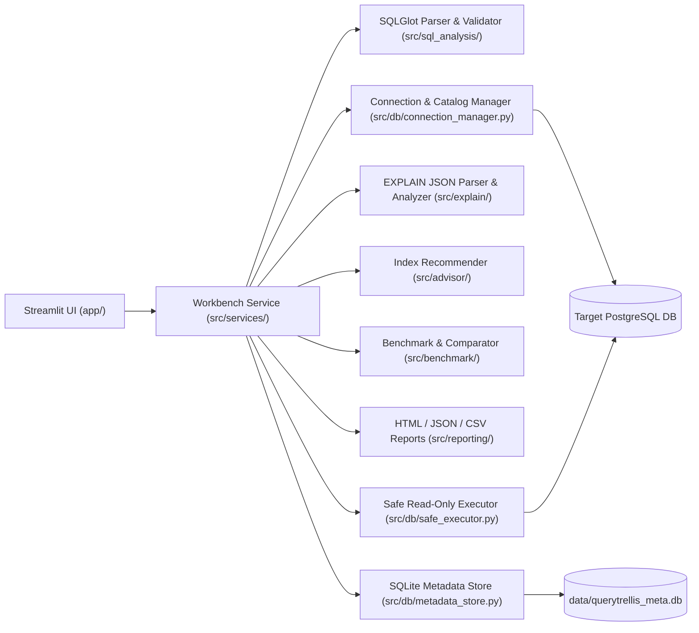

# Architecture — QueryTrellis

## Layered Modular Design

QueryTrellis cleanly separates the Streamlit presentation layer from SQL parsing, PostgreSQL execution, plan analysis, index advising, benchmarking, reporting, and local SQLite persistence.

## Module Responsibilities

| Package / File | Responsibility |
|---|---|
| `src/config/settings.py` | Loads `.env` parameters (`PGHOST`, `PGPORT`, `PGDATABASE`, `PGUSER`, `PGPASSWORD`) and safety guardrails; prevents secret exposure via `to_safe_dict()`. |
| `src/db/connection_manager.py` | Manages `psycopg` v3 connections, database switching, version checks, human-friendly error translation, and `pg_catalog` introspection (`reltuples`, `pg_index`, `indnkeyatts`, `indpred`, foreign keys). |
| `src/db/safe_executor.py` | Runs AST-validated single `SELECT` queries inside `SET TRANSACTION READ ONLY` + `SET LOCAL statement_timeout`, caps UI row fetches via a server-side cursor, and executes `EXPLAIN (ANALYZE, BUFFERS, FORMAT JSON)`. |
| `src/db/metadata_store.py` | Independent SQLite WAL store tracking connection profiles (passwords excluded), query history, plan summaries, benchmarks, comparisons, report logs, and preferences. |
| `src/sql_analysis/parser_validator.py` | Parses PostgreSQL SQL with SQLGlot (`read="postgres"`), enforces single-statement read-only AST rules, and extracts tables, aliases, predicates, joins, sorting, grouping, and pagination info. |
| `src/sql_analysis/antipattern_detector.py` | Evaluates 15 AST + catalog-aware SQL rules (`AP001`–`AP015`) with severity, confidence, evidence basis, acceptable use-cases, and rewrite suggestions. |
| `src/explain/plan_parser.py` | Transforms PostgreSQL `EXPLAIN (FORMAT JSON)` into a hierarchical `PlanNode` tree, computes exclusive node self-time (`actual_total_time * actual_loops - child_inclusive`), and calculates estimate-vs-actual divergence. |
| `src/explain/plan_analyzer.py` | Identifies large-table selective `Seq Scan`, cardinality misestimates, disk-spilled `Sort`, high-loop joins/subplans, heavy buffer reads, and worker under-allocation. |
| `src/advisor/index_recommender.py` | Generates non-redundant single-column, composite (ESR), `INCLUDE` covering, and partial B-tree index recommendations while suppressing duplicates against `pg_catalog`. |
| `src/benchmark/runner.py` & `comparator.py` | Executes multi-run benchmarks (optional warmup, min/median/mean/max/p95/stdev) and compares baseline vs. candidate versions on timing, cost, row equivalence, plan nodes, and anti-patterns. |
| `src/reporting/report_generator.py` | Renders self-contained HTML, structured JSON, and tabular CSV exports with zero credential exposure. |
| `app/` | Fixed-sidebar 8-page Streamlit workstation (`Overview`, `Query Editor`, `Explain Plan`, `Recommendations`, `Benchmark Lab`, `Query History`, `Reports`, `Settings`). |
