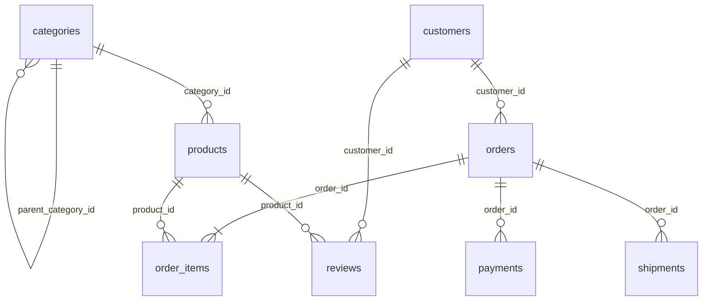

# QueryTrellis Sample E-Commerce Database Schema

The `querytrellis_sample` PostgreSQL database models a realistic B2C/B2B e-commerce platform designed specifically for SQL query tuning, execution plan analysis, and indexing experiments.

## Entity-Relationship Overview

## Table Inventory & Default Target Volumes

| Table | Target Rows | Primary Key | Initial Secondary Indexes | Performance Tuning Purpose |
|---|---|---|---|---|
| `categories` | 25 | `category_id` | `slug` (UNIQUE) | Small lookup table (Seq Scan is optimal) |
| `customers` | 12,000 | `customer_id` | `email` (UNIQUE) | Demonstrates function-on-indexed-col (`LOWER(email)`), leading wildcard `LIKE`, segment filtering |
| `products` | 2,500 | `product_id` | `sku` (UNIQUE), `idx_products_category_id` | Demonstrates indexed vs non-indexed filtering (`category_id` vs `brand`) |
| `orders` | 55,000 | `order_id` | None initially | Demonstrates FK join scans, date-range sargability, composite `(customer_id, order_date)` and partial `status` index recommendations |
| `order_items` | 120,000 | `order_item_id` | None initially | High-volume line-item table for Hash Join vs Nested Loop, `Sort` memory/disk, and aggregation plans |
| `payments` | 45,000 | `payment_id` | None initially | Payment status filtering, partial indexes (`WHERE payment_status = 'failed'`), and multi-table joins |
| `shipments` | 35,000 | `shipment_id` | None initially | Carrier delivery analytics, nullable timestamp predicates |
| `reviews` | 12,000 | `review_id` | None initially | Correlated subquery vs CTE/JOIN comparison and rating aggregation |

## Why Certain Foreign Keys Are Unindexed Initially

Unlike MySQL/InnoDB, **PostgreSQL does not automatically create indexes on foreign key columns** in referencing child tables. Leaving `orders(customer_id)`, `order_items(order_id)`, `order_items(product_id)`, `payments(order_id)`, and `shipments(order_id)` unindexed out of the box reflects a common production bottleneck that QueryTrellis surfaces via `EXPLAIN (ANALYZE, BUFFERS)` and its Index Recommendation Engine.
